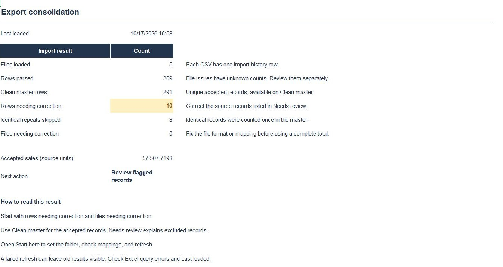

# Excel Export Consolidator

This workbook combines recurring CSV exports into one Excel master and keeps records that need attention in a separate review table. The goal is a refresh someone can repeat without copying and pasting files together each time.

**Power Query runs the workflow inside Excel.** Python provides an independent reference for checking the results; it isn't required to use the workbook.

[Download the workbook](deliverables/Export%20Consolidator.xlsx) · [Refresh guide](docs/REFRESH_GUIDE.md) · [Power Query source](power-query)

## What the sample shows

Five exports contain **309 records: 291 accepted, 10 needing correction, and eight skipped repeats**. Accepted sales total **57,507.7198 source monetary units**. The review table includes both the 10 correction records and eight skipped copies, with source filenames, record numbers, and reasons.

The workbook keeps IDs as text, applies the configured date formats, and checks repeated Row IDs across files. Identical valid copies can be skipped; conflicting copies all go to review. It doesn't choose an amount just because it came from a newer file.

The sample uses a defined **eight-field sales format**. Other exports need agreed mappings and rules before they can use the same workflow. [Data contract](docs/DATA_CONTRACT.md).

## Try it in Excel

1. Download the repository using **Code > Download ZIP**, then extract it.
2. Open the workbook in **Excel Desktop for Windows with Power Query**.
3. On **Start here**, set **Folder** to the absolute path of the extracted `data/incoming` folder.
4. Select **Data > Refresh All**, wait for completion, and check every query and the **Summary** sheet.

Correct records in the source CSVs, then refresh again. Edits to output tables are replaced on refresh. Keep the input folder unchanged while queries run.

Each refresh rebuilds the master from the current folder. **Import history describes that folder snapshot**, rather than a permanent log of earlier refreshes. File errors need attention before the combined total can be treated as complete; a failed query can leave older saved values visible.

## What was checked

A native Excel refresh matched the Python reference. Adding a compatible file changed accepted rows from **291 to 292**; refreshing unchanged inputs kept that result. An unsupported filename appeared as a file issue. Removing the test files restored the baseline.

[Native validation](evidence/native-validation.json) · [Python reference](src/consolidate.py) · [Tests](tests) · [Verification scope](docs/QA.md)

## Documentation

- [Operating guide](docs/PROJECT_GUIDE.md) · [Client handoff](docs/CLIENT_HANDOFF.md)
- [Implementation and rebuild](docs/TECHNICAL.md) · [Sample provenance](docs/SAMPLE.md)
- [Walkthrough](docs/PORTFOLIO.md) · [Practice exercise](docs/INDEPENDENT_PRACTICE.md)

[Data Workbench](https://github.com/ZakJRademacher/data-workbench) is a separate local app for configurable CSV/XLSX preparation and related-table joins. This workbook remains the native Excel/Power Query option for its documented sales format. [Comparison and limits](https://github.com/ZakJRademacher/data-workbench/blob/main/docs/COMPARISON.md). The [earlier CSV workbench](https://github.com/ZakJRademacher/cloud-file-intake/blob/main/docs/WORKBENCH.md) is also preserved separately.

This independent project uses historical Kaggle Superstore values with disclosed export variations and deliberately introduced test defects. The source doesn't establish a currency. Code and documentation: [MIT](LICENSE). Dataset-derived files retain the source's GPL 2 label; see [data attribution](licenses/DATA.md).
