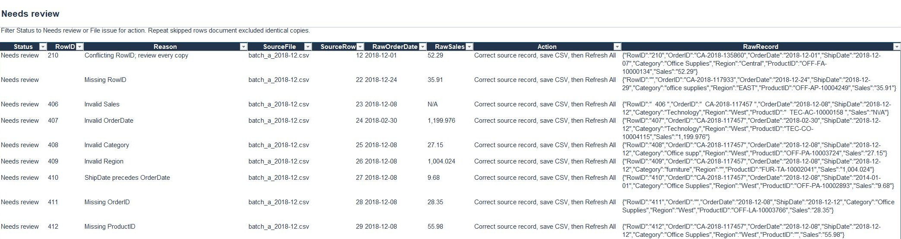

# Operating and reproduction guide

[Back to project overview](../README.md)

Run commands from the repository root. Paths in command examples are relative to that root.

## Weekly use

Place compatible exports in the configured folder and select **Refresh All**. Correct problems in the source CSVs, then refresh again. Output tables are regenerated, so manual output edits are not retained.

Each refresh rebuilds the master from the files currently in the folder. Retain files that belong in the current master. Replace a corrected file instead of leaving both old and corrected versions. **Import history is a current snapshot, not an append-only audit trail.**

This is a configured sales-export example, not a universal CSV importer. A different client's exports require agreed field mappings, date formats, categories, business keys, and validation rules.



## Verified in Excel

The delivered workbook was refreshed in Excel Desktop for Windows, then its saved tables and summary values were independently compared against the Python reference. Adding an export changed accepted rows from **291 to 292** and accepted sales from **57,507.7198 to 57,522.6718**. An unchanged refresh retained those results. An unsupported filename appeared as **one file issue**. Removing the two test files and refreshing restored the baseline. See the [native validation record](../evidence/native-validation.json).

## Documentation

- [Refresh guide and troubleshooting](../docs/REFRESH_GUIDE.md)
- [Data contract and duplicate rules](../docs/DATA_CONTRACT.md)
- [Sample provenance and deliberate defects](../docs/SAMPLE.md)
- [Implementation and rebuild notes](../docs/TECHNICAL.md)
- [Validation scope and evidence](../docs/QA.md)
- [Client handoff and adaptation checklist](../docs/CLIENT_HANDOFF.md)
- [Portfolio walkthrough and interview notes](../docs/PORTFOLIO.md)

## Reproduce the reference results

Requires Python 3.10 or later, with no third-party packages:

```console
python src/prepare_sample.py
python src/consolidate.py
python -m unittest discover -s tests -v
```

The preparation command recreates the five demonstration exports and configuration CSVs from the included frozen source partition. Run it only when you intend to reset the sample files. It does not refresh Excel. Configuration CSVs support the reference engine; Excel reads its settings tables on **Start here**.

## Source and scope

Historical sales values come from Rohit Sahoo's [Superstore Sales Dataset on Kaggle](https://www.kaggle.com/datasets/rohitsahoo/sales-forecasting). The demonstration uses the first 300 records from a frozen December 2018 partition, with disclosed export variations and seeded defects. These are demonstration conditions, not observed client errors or claimed business savings.

Code and documentation use the [MIT license](../LICENSE). Dataset-derived files retain the source's GPL 2 label; see [data attribution](../licenses/DATA.md).
